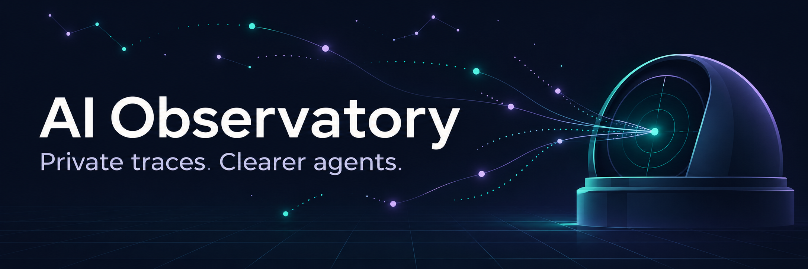

# 🔭 AI Observatory — Local-First Coding Agent Observability

   

AI Observatory is a local-first, self-hosted observability stack for coding agents. Trace OpenCode sessions, model generations, and tool calls with [Langfuse](https://langfuse.com/) and OpenTelemetry, using Docker Compose on macOS or Linux. Optionally reach the private dashboard from other devices on your Tailscale network.

OpenCode is the coding-agent integration currently supported by this repository; additional integrations are future work.

[Read the documentation](https://dmoliveira.github.io/coding-agent-observability/) · [Security and privacy](docs/security.md) · [Third-party notices](THIRD_PARTY_NOTICES.md)

**By default nothing is published to the LAN or tailnet.** Docker publishes the web and media ports on localhost only. Tailscale sharing is a separate, explicit step; it is not Tailscale Funnel or public internet access.

> Once enabled, traces can contain prompts, previous conversation context, reasoning, source code, tool inputs and outputs, and secrets. Only trace data you are allowed to store. See [security and privacy](docs/security.md).

## 🚀 Start the server

Requirements: macOS or Linux, Python 3.10+, Docker Engine **28+** with Docker Compose, Make, and free localhost ports `3000` and `9090`. The initial image downloads require internet access. On macOS, start Docker Desktop first.

```sh
git clone https://github.com/dmoliveira/coding-agent-observability.git
cd coding-agent-observability
make help
make doctor
make setup
make up
make verify
make open
```

`make setup` asks for an administrator password and creates a private `.env` with unique instance secrets. The default account is `admin@ai-observatory.local`; set `AI_OBSERVATORY_ADMIN_EMAIL` before setup to use a different address. Use a password of at least 16 letters, numbers, underscores or hyphens. Setup will not overwrite an existing configuration.

Sign in at <http://127.0.0.1:3000>. In the **Coding Agents** project, create a Langfuse API key under project settings; keep both the public and secret key for the next step. Signups are disabled by default.

```sh
make status              # container health
make logs                # may contain sensitive data
make down                # stop and remove containers, keep volumes
make up                  # start again with the same data
```

Keep `.env` private and backed up: it includes your administrator password and the keys needed to read stored data. Docker administrators and other users with sufficient host access can also access container data.

### Optional: Bitwarden administrator password

The [Bitwarden CLI](https://bitwarden.com/help/cli/) can supply the administrator
password during startup. Store the existing Langfuse login in Bitwarden first;
the original password is in `ADMIN_PASSWORD` in `.env` unless it was changed in
Langfuse. Do not print or paste passwords or session keys into an agent session.

In your own terminal, with shell tracing (`set -x`) disabled, authenticate and
unlock the CLI separately from the browser extension. These commands capture the
session key instead of printing it:

```sh
export BW_SESSION="$(bw login --raw)"  # first CLI login
# OR, if already logged in but locked:
export BW_SESSION="$(bw unlock --raw)"
```

Sync the CLI, then find the login's ID without displaying its password; replace
the search text with the name you used in Bitwarden. The command lists only
login item IDs and names:

```sh
bw sync
bw list items --search "AI Observatory" | python3 -c 'import json,sys; [print(i["id"], i["name"]) for i in json.load(sys.stdin) if i.get("type") == 1]'
```

Select the correct ID and start the stack in the same terminal:

```sh
export AI_OBSERVATORY_BITWARDEN_ITEM="<login-item-id>"
make up
```

The item password must have at least 16 letters, digits, underscores or hyphens,
matching the setup rules. If the CLI is missing, locked, times out, the ID is
invalid, or the password does not meet those rules, startup warns and uses the
existing `.env` value instead. On success it confirms the source without printing
the password. A different valid Bitwarden password is used with a warning; it
does **not** change an existing Langfuse login. Initialization only creates the
account if it does not already exist. Change an existing login in Langfuse itself,
not by editing Bitwarden or `.env`. Changing the startup value can cause Compose
to recreate the web container; its data volumes are preserved.

Keep `.env` private, unchanged and backed up: it remains required and still
contains plaintext secrets. The CLI session is not passed to Docker, but Docker
administrators can inspect container configuration. A new shell needs its own
unlocked CLI session and item selection; run `unset BW_SESSION` when finished.
You can save the non-secret item ID in your shell profile, but never save the
session key or master password there.

## 🧩 Trace OpenCode by default

Install OpenCode 2 and Node.js 22+ on the machine running OpenCode. From a terminal, run once:

```sh
make connect-opencode-global
```

Enter the **Coding Agents** project's public and secret Langfuse keys when prompted. The installer verifies them and saves them privately under `~/.config/ai-observatory/` (or `$XDG_CONFIG_HOME`). It then enables tracing for ordinary OpenCode sessions across projects without changing your existing OpenCode configuration. An already-running service can load the plugin immediately; a future request can include prior session context in its traces.

To start a new session without **this integration's** tracing:

```sh
AI_OBSERVATORY_DISABLED=1 opencode --standalone
```

The standalone flag is important: a normal client connects to the already-running shared service, whose environment it cannot change. Other plugins and telemetry exporters are independent and may still record data. Existing traces are not erased. See the [integration guide](docs/opencode.md) for coverage, limitations, and the older per-project launcher.

## 🔐 Share with another Tailscale machine

On the **server**, connect Tailscale, enable MagicDNS and HTTPS certificates in your tailnet, and review the tailnet's ACLs or grants for ports `15443` and `15444`. Start the stack, then explicitly enable sharing:

```sh
make up
make tailscale-on
```

The command prints the private HTTPS web address. Both dedicated ports must be unused; existing Serve and Funnel configuration is preserved, and concurrent changes are rejected. Enabling Tailscale HTTPS can publish the machine and tailnet DNS name in Certificate Transparency, even though the service is tailnet-only. Tailnet administrators and devices allowed by your grants can reach it; Tailscale does not replace Langfuse authentication.

On the **client machine**, join the same tailnet and clone the repository. It needs Python, Make, OpenCode 2 and Node.js 22+, but **not Docker or a local server**. Set the trusted server URL printed above and connect OpenCode once:

```sh
AI_OBSERVATORY_URL=https://your-server.your-tailnet.ts.net:15443 \
  make connect-opencode-global
```

Use the hostname and key from your own server; a `.ts.net` suffix alone does not prove that a host is private or trustworthy. This client-only path is intentionally simple; a dedicated installer can be added later.

To stop sharing, run `make tailscale-off` on the server. `make down` also attempts to remove this instance's routes and stops the stack. Never use `tailscale serve reset`: it can remove unrelated routes. If cleanup fails, inspect `tailscale serve status` and follow [the security guide](docs/security.md#tailscale-recovery).

## 📦 Backup and restore

Backups include PostgreSQL, ClickHouse, Redis queues, MinIO, and `.env` secrets. **They are unencrypted and contain credentials and all trace data. Encrypt them before copying or storing them elsewhere.**

1. Stop traced clients, flush their telemetry, and allow ingestion queues to drain.
2. On the server, stop the stack and create a backup:

   ```sh
   make down
   make backup
   make up                 # optional: restart after backup completes
   ```

3. Store the resulting `backups/*.tar.gz` securely. Only restore archives you trust.
4. To restore, use a **fresh checkout** of the same repository version on the same Docker architecture, without an `.env` or running instance in that checkout:

   ```sh
   make restore BACKUP=/absolute/path/to/backup.tar.gz
   make up
   make verify
   ```

Restore creates newly named volumes, preserves the original instance and archive, and defaults to localhost. If both instances are on the same machine, stop the original before starting the restored copy, or deliberately choose different local ports in its `.env` and matching URLs. Validate login and representative traces/media before relying on a restore. Checksums detect accidental corruption, not malicious modification. Do not run backup concurrently with another Docker command that starts or attaches the same volumes.

## 🛠️ Develop the documentation site

The [documentation site](https://dmoliveira.github.io/coding-agent-observability/) is built from this README and the Markdown guides in `docs/`. With Node.js 22 or newer, run `make site-build` and open `site/dist/index.html` locally. The generated site is ignored by Git and contains only an explicit allowlist of public files. `make check` includes the site tests; after building, `npm --prefix site run test:browser` optionally checks responsive layouts using a local Chrome installation.

## 🗺️ Later

Dashboards and extracted metrics, batch evaluation workflows, a dedicated multi-machine installer, and deeper `my_opencode` integration are future work—not requirements for the initial local stack.

## 💜 Support

If this project helps you, [support its development](https://buy.stripe.com/8x200i8bSgVe3Vl3g8bfO00).

The repository code is MIT licensed; Langfuse and other components have their own licenses and terms. See [third-party notices](THIRD_PARTY_NOTICES.md).
